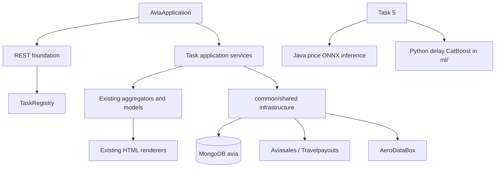

# Spring Boot backend architecture

## Назначение рефакторинга

Java-приложение преобразовано в Spring Boot 3 backend на Java 17 и разделено по пяти учебным задачам. Математика агрегаторов, Mongo-схема, существующие HTML-renderers и Python ML не переписывались. Цель этого этапа — дать аналитике явные application-service boundaries, конфигурацию через environment и минимальную REST-основу для будущего frontend.

Maven root временно оставлен в корне репозитория. Перенос всего проекта в `backend/` затронул бы множество рабочих относительных путей (`data/`, `reports/`, resources и standalone checks) и создавал бы риск, не связанный с package separation. Физическое разделение Java-кода выполнено полностью; перенос Maven root можно сделать отдельным контролируемым этапом.

## Структура репозитория

```text
.
├── pom.xml
├── src/main/java/avia
│   ├── AviaApplication.java
│   ├── Main.java
│   ├── MongoMain.java
│   ├── common/
│   ├── task1/
│   ├── task2/
│   ├── task3/
│   ├── task4/
│   ├── task5/{price,delay}/
│   └── web/
├── src/main/resources/application.yml
├── ml/
├── models/
├── data/
└── docs/
```

## Поток зависимостей



REST не читает готовый HTML. В будущем controller сможет вызывать тот же task service и возвращать JSON, тогда как compatibility CLI продолжит передавать результат в существующий renderer.

## Package boundaries

| Task | Package | Main services | Shared dependencies |
|---|---|---|---|
| 1 — сезонность и дешёвые направления | `avia.task1` | `Task1Service`, `SeasonalityAggregator`, `CheapestDestinationAggregator` | `common.aviasales`, `common.price.mongo` |
| 2 — прямые рейсы и пересадки | `avia.task2` | `Task2Service`, `TransferStats`, `PairedTransferStats`, `TransferComparisonAggregator` | `common.aviasales`, `common.price` |
| 3 — описательный анализ задержек | `avia.task3` | `Task3Service`, `DelayAnalyzer`, `FlightHistoryAggregator`, `DelayVisualizationAggregator` | `common.aerodatabox`, `common.flight`, `common.mongo` |
| 4 — цены авиакомпаний | `avia.task4` | `Task4Service`, `AirlineStats` | `common.price`, `common.price.mongo` |
| 5 — ML-прогнозирование | `avia.task5.model`, `avia.task5.price`, `avia.task5.delay` | `FlightPredictionRequest`, `Task5PricePredictionService`, `PricePredictionService`, `Task5DelayProfileService` | `common.flight`; Python `ml/` и `models/` |

Task 3 не импортирует классы из `task5` и содержит только descriptive analytics. `FlightRecord`, `FlightHistoricalStats`, `FlightServiceIdentity`, порядок наблюдений и Mongo readers являются shared infrastructure, потому что используются и Task 3, и Task 5 delay.

`avia.task5.model.FlightPredictionRequest` — единый публичный DTO будущего `POST /api/tasks/5/predict` для обеих
веток Task 5. Python delay inference зеркалирует тот же JSON contract. Перед delay inference профиль проверяется по
`_id` в `avia.predictable_flight_profiles`; отсутствие профиля возвращает `UNSUPPORTED_PROFILE` до CatBoost.

## Shared/common

- `avia.common.config` — typed Spring properties и bean configuration.
- `avia.common.mongo` — общий bulk-upsert helper.
- `avia.common.aviasales` — Travelpayouts client, collection services и raw storage.
- `avia.common.aerodatabox` — AeroDataBox client, DTO, collection и raw storage.
- `avia.common.flight` — нормализация, чтение/запись и shared flight domain.
- `avia.common.price` — общие справочники, cleaning и чтение `offers_clean`.

Collector и Cleaner остаются CLI-инструментами. Они не вызываются при старте Spring и не запускались в рамках рефакторинга.

## Spring configuration

Entry point: `avia.AviaApplication` с `@SpringBootApplication` и `@ConfigurationPropertiesScan`.

`application.yml` использует только placeholders:

| Property | Environment variable | Default |
|---|---|---|
| Mongo URI | `MONGO_URI` | `mongodb://127.0.0.1:27017/?serverSelectionTimeoutMS=3000` |
| Mongo database | — | `avia` |
| Aviasales token | `AVIASALES_TOKEN` | empty |
| AeroDataBox key | `AERODATABOX_API_KEY` | empty |

Mongo synchronous driver сохранён. `MongoClient` зарегистрирован как lazy Spring bean, поэтому запуск backend и unit tests не открывают соединение без реального потребителя. External API clients создаются условно только при наличии соответствующего credential. Реальные API requests при старте не выполняются.

## REST foundation

- `GET /api/health` → `{"status":"UP"}`.
- `GET /api/tasks` → metadata ровно пяти задач из `TaskRegistry`.

Analytics/chart endpoints намеренно отсутствуют на этом этапе.

## Запуск и проверка

Из корня репозитория:

```powershell
mvn clean test
mvn spring-boot:run
```

После packaging:

```powershell
mvn clean package
java -jar target/avia-backend.jar
```

## CLI compatibility

`avia.Main` и `avia.MongoMain` сохранены как facades. Имена внутренних классов изменились, но пользовательские flags и аналитическая семантика не менялись. Из repackaged ZIP-layout archive старый dispatcher запускается так:

```powershell
java -Dloader.main=avia.Main -jar target/avia-backend.jar <старые аргументы>
java -Dloader.main=avia.MongoMain -jar target/avia-backend.jar <старые Mongo-аргументы>
```

Отдельные CLI перемещены в task/common packages; их replacement class names:

| Old class | New class |
|---|---|
| `avia.DatasetCli` | `avia.task3.cli.DatasetCli` |
| `avia.MongoDelayDashboardCli` | `avia.task3.cli.MongoDelayDashboardCli` |
| `avia.MongoFlightStatisticsCli` | `avia.task3.cli.MongoFlightStatisticsCli` |
| `avia.MongoPredictableFlightProfilesCli` | `avia.task5.delay.cli.MongoPredictableFlightProfilesCli` |
| `avia.AviasalesPricesBulkCollectorCli` | `avia.common.aviasales.cli.AviasalesPricesBulkCollectorCli` |
| `avia.AeroDataBoxBulkCollectorCli` | `avia.common.aerodatabox.cli.AeroDataBoxBulkCollectorCli` |

## Future direction

Следующий этап может добавлять task-specific REST controllers поверх `Task1Service`…`Task5*Service` и JSON DTO, не связывая REST с HTML. Python CatBoost delay-v2 пока не является REST service и остаётся самостоятельным компонентом Task 5. Артефакт `price_model.onnx` отсутствует; ONNX service загружает его лениво только при запросе inference, поэтому это известное ограничение не мешает запуску backend.
